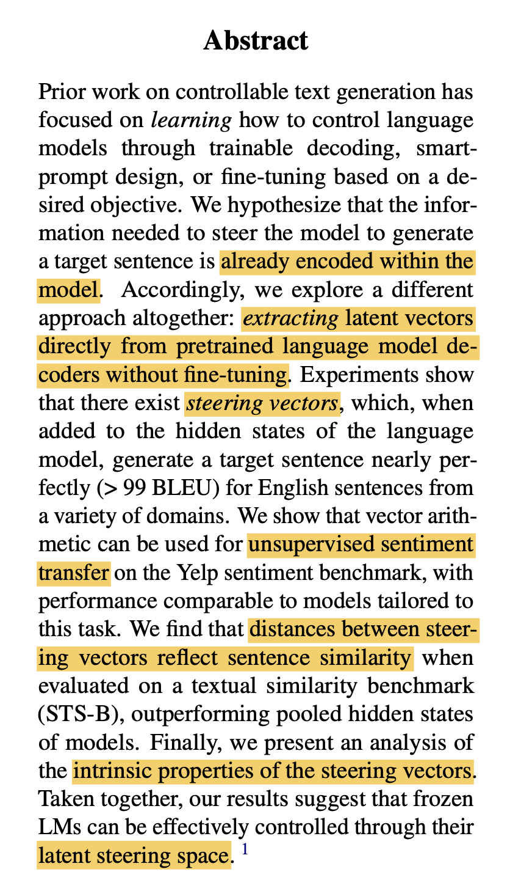

# Extracting Latent Steering Vectors from Pretrained Language Models

**Authors:** Nishant Subramani, Nivedita Suresh, Matthew Peters  
**Year:** 2022  
**Venue:** Findings of ACL 2022 (peer-reviewed)  
**Citation key:** `subramani2022_extracting_steering_vectors`  
**BibTeX entry:** [entry](../../bib.bib)  
**PDF:** [ACL Anthology](https://aclanthology.org/2022.findings-acl.48.pdf)  
**DOI:** [10.18653/v1/2022.findings-acl.48](https://doi.org/10.18653/v1/2022.findings-acl.48)  
**Google Scholar:** [Search](https://scholar.google.com/scholar?q=Extracting+Latent+Steering+Vectors+Subramani+2022)

## Summary

Proposes extracting fixed-length **steering vectors** directly from frozen pretrained decoder LMs (GPT-2 in experiments) without fine-tuning. Adding a steering vector to hidden states during decoding can recover target English sentences with >99 BLEU across domains. Vector arithmetic on extracted steering vectors supports unsupervised Yelp sentiment transfer at performance comparable to tailored autoencoder models. Cosine distances between steering vectors track semantic similarity on STS-B, beating pooled LM hidden states and GloVe but not specialized lexical or NLI-finetuned baselines. Analysis shows interpolations decode meaningfully, domain-specific vectors cluster, and extraction leverages the model rather than naive sequence memorization.

## Details

### Methodology overview

**Intervention.** Instead of fine-tuning or editing logits, the paper adds \(z_{\mathrm{steer}}\) to the model’s hidden states at a chosen point in the transformer stack (Figure 1 above). Concretely: at injection layer \(IL\) and timestep(s) \(IT\), the activation is replaced by \(h \leftarrow h + z_{\mathrm{steer}}\) (or \(h + W_{\mathrm{steer}} z_{\mathrm{steer}}\) if dimension is reduced). No new layers or adapters — one vector broadcast/added into the residual stream.

**Target sentence \(x\).** Any fixed English sentence the experiment chooses in advance — e.g. a line from movie dialog, Gutenberg, news, or Wikipedia in their multi-domain dataset (Section 3.1). The task is: find \(z_{\mathrm{steer}}\) such that GPT-2, given only the beginning-of-sequence (BOS) token — GPT-2’s start-of-generation symbol, with no other words in the prompt — plus that vector, generates \(x\) (or assigns it very high likelihood during extraction). \(x\) is ground truth for optimization and for BLEU evaluation; it is not shown to the model at decode time.

**Two phases:**

| Phase | Input to GPT-2 | What is optimized | Purpose |
|-------|----------------|-------------------|---------|
| Extraction | Target sentence \(x\) token-by-token (teacher forcing) | Only \(z_{\mathrm{steer}}\) via CE loss on \(x\) | Find a \(z\) that makes the frozen LM assign high probability to \(x\) |
| Steering / eval | Beginning-of-sequence (BOS) token only | Nothing — \(z_{\mathrm{steer}}\) fixed | Greedy-decode from BOS with \(z_{\mathrm{steer}}\) injected; check whether output ≈ \(x\) (BLEU-4) |

**Why fixed length.** Unlike a variable-length hidden state per token, one \(z_{\mathrm{steer}}\) per sentence lets vectors for short and long sentences live in the same space (enabling later cosine similarity, offsets, interpolation).

### How steering vectors are extracted

**Learning (extraction phase).** For each target sentence \(x = (x_1, \ldots, x_T)\):

1. Initialize \(z_{\mathrm{steer}} \in \mathbb{R}^{d'}\) at random (Xavier normal; typically \(d' = d = 768\) for GPT-2-117M).
2. Freeze all LM weights \(\theta\); \(z_{\mathrm{steer}}\) is the only parameter with gradients.
3. Optimize \(z_{\mathrm{steer}}\) for \(N\) Adam steps: teacher-force \(x\) through the frozen LM, add \(z_{\mathrm{steer}}\) at layer \(IL\) / timestep(s) \(IT\), minimize cross-entropy on \(x\); gradients update \(z_{\mathrm{steer}}\) only (Algorithm 1).

**Using the learned vector (steering / eval).** Fix \(z_{\mathrm{steer}}\). Start from BOS only (empty prompt), inject the same \(z_{\mathrm{steer}}\) at the same \(IL, IT\), and greedy-decode autoregressively. Compare output to \(x\) (BLEU-4).

**Results (Section 3).** On a multi-domain set (movie dialog, Gutenberg books, news, WikiText), greedy decode from BOS + \(z_{\mathrm{steer}}\) nearly reproduces the target verbatim: BLEU-4 100.0 when injecting at layer 6 or 7 (self-attention or FFN), even at the first timestep only (99.25–99.80).

**Discussion.** Partly expected: with only BOS, something must condition the decode—and a 768-d vector fit (with teacher forcing on \(x\)) at mid layers is a high-dimensional substitute for a text prefix that says “generate this sentence.” Less trivial: at eval the model never sees \(x\); injection layer matters a lot; and the same \(z\)-space later supports similarity, interpolation, and sentiment arithmetic (Sections 4–6). The paper does not test steering alongside a natural-language prompt.

### Unsupervised sentiment transfer

**Yelp benchmark (Section 4).** Sentiment transfer is evaluated on the Yelp Sentiment dataset as preprocessed by Shen et al. (2017) — short review snippets with positive/negative labels, the standard unsupervised style-transfer setup from that line of work. The method is *unsupervised* in the sense that no paired (positive, negative) rewrites of the same review are used: class-mean offsets are estimated from 100 validation sentences per polarity, transfer is applied to the held-out test set, and GPT-2 is never fine-tuned on Yelp for this task. Success is scored two ways (Figure 3): sentiment accuracy (RoBERTa-base fine-tuned on Yelp labels the generated text) and self-BLEU (BLEU-4 to the original review for content preservation). Steering vectors are injected at layer 7 after self-attention, first timestep only; \(\lambda\) is swept over \(\{0.25, \ldots, 10.0\}\). The curve is comparable to Shen et al. (2017) autoencoder baselines despite using far less labeled data for the offset.

**The idea (not “Yelp average → one vector”).** You do not average review text or hidden states into a steering vector. The pipeline is:

1. Per sentence: extract a sentence-specific \(z_{\mathrm{steer}}\) (Section above) for many Yelp reviews — one optimized vector per review.
2. Per class: average those vectors within labeled positive reviews → \(\bar z_{\mathrm{positive}}\), and within negative → \(\bar z_{\mathrm{negative}}\) (100 validation sentences per class).
3. Offset: \(z_{+\to-} = \bar z_{\mathrm{negative}} - \bar z_{\mathrm{positive}}\) — a direction in steering space that approximates “move from positive-style to negative-style generation,” analogous to word-vector analogies (\(\vec{\mathrm{king}} - \vec{\mathrm{man}} + \vec{\mathrm{woman}}\)).
4. Transfer one review: for a test sentence with vector \(z_{\mathrm{source}}\), form \(\hat z = z_{\mathrm{source}} + \lambda \, z_{+\to-}\) (Eq. 3), inject \(\hat z\), decode from BOS. Scale \(\lambda\) controls strength.

So the Yelp average is an average of steering vectors, not of sentences — and it is used only to estimate a shared offset direction, then applied per sentence via that sentence’s own \(z_{\mathrm{source}}\).

**Why do this?** Section 3 shows \(z_{\mathrm{steer}}\) can pin down *which sentence* GPT-2 generates. Section 4 tests a stronger claim: 

- **steering space is structured enough that vector arithmetic moves an attribute (sentiment) while leaving content roughly fixed** — without training an autoencoder or fine-tuning GPT-2 on paired data.

**What to expect.**

- Small \(\lambda\): output ≈ original sentence (sentiment barely changes); high self-BLEU.
- Larger \(\lambda\): sentiment adjectives flip (*excellent* → *unpleasant*, *bland* → *tasty* in Table 2); RoBERTa sentiment accuracy rises.
- Too large \(\lambda\): repetition, broken fluency (Table 2: *bitter and bitter*); self-BLEU drops. Negative→positive transfer tends to work better than positive→negative.

**How the paper measures against those expectations** (Figure 3 — accuracy vs self-BLEU tradeoff):

| Metric | Measures | Good outcome |
|--------|----------|--------------|
| Sentiment accuracy | RoBERTa-base (fine-tuned on Yelp) labels the generated text — did polarity flip? | High accuracy at moderate \(\lambda\) |
| Self-BLEU | BLEU-4 between generated text and the original input sentence | High = content preserved; drops if \(\lambda\) too strong |

You want both: flip sentiment *and* keep the review’s factual content. Figure 3 traces the Pareto frontier as \(\lambda\) varies; the method is compared to Shen et al. (2017) autoencoder baselines (similar curve, but this method uses no paired training and only ~100 labeled examples per class to estimate class means).

**Table 2 examples:** positive *"the taste is excellent!"* + \(2.0 \cdot z_{+\to-}\) → *"the taste is unpleasant."*; negative *"the desserts were very bland."* + \(2.0 \cdot z_{+\to+}\) → *"the desserts were very tasty."*

### Sentence similarity (STS-B)

Not cherry-picked sentence pairs — correlational evaluation on STS-B test: extract \(z_{\mathrm{steer}}\) per sentence, compute cosine similarity between pairs, correlate with human similarity ratings (Spearman \(\rho\)).

| Method | Spearman \(\rho \times 100\) |
|--------|------------------------------|
| Mean-pooled GPT-2 final hidden states | 25.92 |
| Mean-pooled BERT | 47.29 |
| Mean-pooled GloVe | 42.53 |
| Layer-7 self-attention steering (ours) | 52.04 |
| Layer-7 FFN steering (ours) | 52.08 |
| SBERT-NLI (supervised for similarity) | 77.03 |

Supporting geometry: t-SNE of 8 random initializations × 20 sentences → 20 tight clusters (one per sentence); vectors for the *same* sentence sit much closer than vectors for different sentences (Figure 2). Mean of 8 seeds per sentence still recovers at BLEU 99.4.

### Intrinsic properties (Section 6)

- Interpolation (Figure 5): linear blends \(z_1 + \lambda(z_2 - z_1)\) decode grammatically, mixing content and sentiment smoothly; e.g. one pair keeps positive tone of sentence 1 through \(\lambda = 0.7\) while content shifts; another pair blends temporal wording (*"four"* + *"years ago"* / *"young"*).
- Neighborhood volume: around each sentence’s steering vectors there is a region where any vector in that region still recovers the same target sentence.
- Intrinsic dimension (Table 4): recovery BLEU rises with \(z_{\mathrm{steer}}\) dimension (192→43, 384→83, 576→94, 768→100); task needs up to full hidden size; longer sentences need higher dimension.
- Not mere memorization (Figure 6): recovery on real books > shuffled tokens > random gibberish — vectors use LM structure and word order, not a lookup table.
- Sampling: treating dimensions as independent Gaussians fit to 4000 Yelp vectors yields mostly broken outputs (5/24 well-formed) — space is smooth locally but not globally Gaussian.
- Prompting baseline: concatenating \(k\) steering vectors as pseudo-tokens underperforms direct hidden-state injection.

### Latent steering space vs activation space

**Activation space** (usual usage): the model’s internal hidden states \(h_\ell(t)\) at layer \(\ell\), timestep \(t\) — one high-dimensional vector per token position, determined by input context.

**Steering vector** \(z_{\mathrm{steer}}\) (this paper): one sentence-specific vector per target, optimized *outside* normal inference and added to activations as a control knob.

**Latent steering space:** the collection of all such \(z_{\mathrm{steer}}\) under a fixed LM (roughly one point per sentence). Mean, offset, and interpolation are defined between these vectors in \(z\)-space — not in the raw activations \(h_\ell(t)\) from a single forward pass.

Same dimension as hidden states (768) and injected *into* activations, but conceptually distinct: activations are computed by the network; steering vectors are free parameters fit post hoc to encode “generate this sentence” (and support arithmetic across sentences). Fixed-length \(z\) also makes cross-sentence comparison independent of sequence length.

## Key concepts

- **Steering vectors** — latent vectors extracted from frozen decoders that steer generation toward a target sentence when added to activations.  
- **Latent steering space** — set of steering vectors associated with sentences under a fixed LM.  
- **Vector arithmetic** — offset vectors for attribute transfer (e.g. sentiment) in steering space.  
- **Middle-layer injection** — best recovery when steering vectors are added in mid transformer layers.

## Notes

Early ACL Findings paper on activation-level control of frozen LMs; predates later activation engineering / contrastive steering work ([`turner2024steeringlanguagemodelsactivation`](turner2024steeringlanguagemodelsactivation.md), [`panickssery2024steeringllama2contrastive`](panickssery2024steeringllama2contrastive.md)). Code: [github.com/nishantsubramani/steering_vectors](https://github.com/nishantsubramani/steering_vectors).
