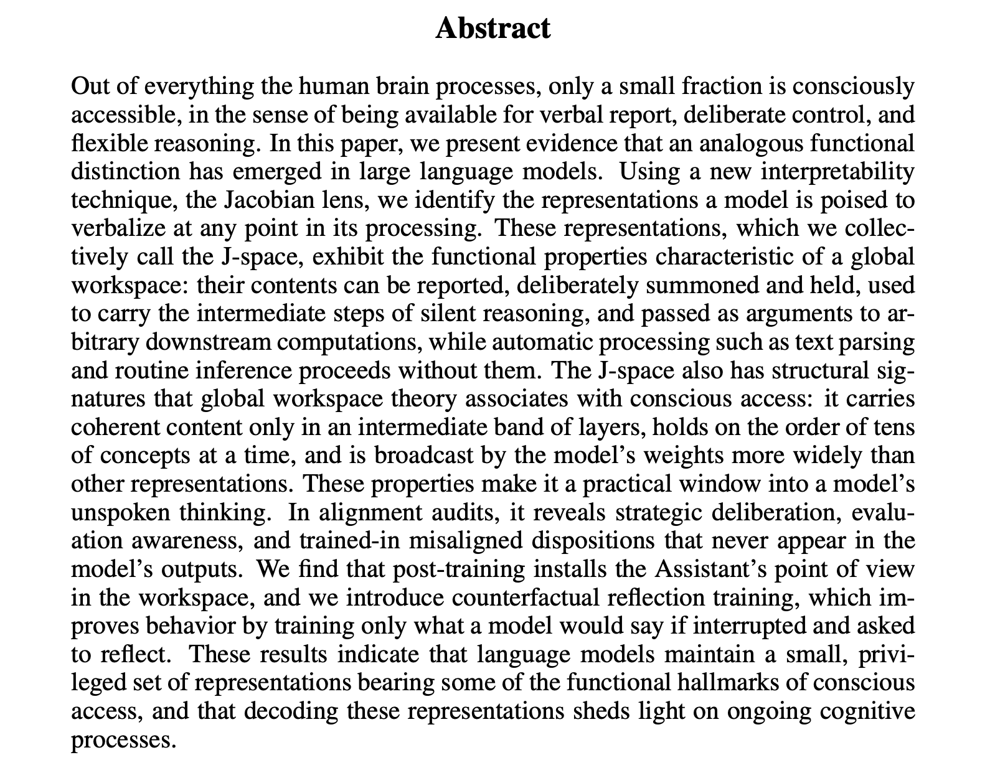

# Verbalizable Representations Form a Global Workspace in Language Models

**Authors:** Wes Gurnee, Nicholas Sofroniew, Adam Pearce, Mateusz Piotrowski, Isaac Kauvar, Runjin Chen, Anna Soligo, Paul Bogdan, Euan Ong, Rowan Wang, Ben Thompson, David Abrahams, Subhash Kantamneni, Emmanuel Ameisen, Joshua Batson, Jack Lindsey  
**Year:** 2026  
**Venue:** Anthropic Transformer Circuits thread; also arXiv:2607.15495  
**Citation key:** `gurnee2026_global_workspace`  
**BibTeX entry:** [entry](../bib.bib#L900)  
**URL:** [transformer-circuits.pub](https://transformer-circuits.pub/2026/workspace/index.html)  
**PDF:** [arXiv](https://arxiv.org/pdf/2607.15495)  
**arXiv:** [2607.15495](https://arxiv.org/abs/2607.15495)  
**Google Scholar:** [Search](https://scholar.google.com/scholar?q=Verbalizable+Representations+Form+a+Global+Workspace+Gurnee)

## Details

> "Out of everything the human brain processes, only a small fraction is consciously accessible, in the sense of being available for verbal report, deliberate control, and flexible reasoning. In this paper, we present evidence that an analogous functional distinction has emerged in large language models. Using a new interpretability technique, the Jacobian lens, we identify the representations a model is poised to verbalize at any point in its processing."

### Jacobian lens

The Jacobian lens characterizes a residual-stream activation by its first-order causal effect on present and future output logits, averaged over contexts—so it reads what the model is disposed to say. The construction starts from causal sensitivity. Fix layer \(\ell\) and source position \(t\). A perturbation of \(h_{\ell,t}\) propagates through the remaining blocks and shifts the final residual \(h_{\mathrm{final},t'}\) at every \(t' \ge t\). To first order, that map is the Jacobian \(\partial h_{\mathrm{final},t'}/\partial h_{\ell,t}\). A single-prompt Jacobian mixes (i) a general disposition to verbalize a concept with (ii) that concept’s local use in the current context. Isolating (i) is done by averaging within and across contexts:

\[
J_\ell \;=\; \mathbb{E}_{t,\, t'\ge t,\, \mathrm{prompt}}\Bigl[\frac{\partial h_{\mathrm{final},t'}}{\partial h_{\ell,t}}\Bigr],
\]

over source positions, later positions in the same context, and a corpus of ~1000 pretraining-like prompts. The result is one \(d_{\mathrm{model}}\times d_{\mathrm{model}}\) matrix per layer.

The paper then defines the **Jacobian lens readout** of an activation by replacing all layers after \(\ell\) with this linear map, then applying the model’s own unembedding (typically LayerNorm then \(W_U\)):

\[
\mathrm{lens}(h_\ell) \;=\; \mathrm{softmax}\bigl(W_U\,\mathrm{norm}(J_\ell h_\ell)\bigr).
\]

Top-scoring vocabulary items are a human-readable description of what that activation is, on average, poised to make the model say. Separately, it names the *rows* of \(W_U J_\ell\) the **J-lens vectors** at layer \(\ell\) (one residual-stream direction per vocabulary token), and calls their span the **J-space**. What is formal in the paper is the matrix \(J_\ell\), the map \(\mathrm{lens}(\,\cdot\,)\), the J-lens vectors, and (more loosely) J-space as that subframe. “The Jacobian lens” names the whole procedure: fit \(J_\ell\) by backprop and averaging, then read or intervene in those coordinates.

**Background (lens methods).** In this literature a *lens* is a way to turn an intermediate residual-stream vector \(h_\ell\) into a distribution (or ranking) over vocabulary tokens—i.e. to ask what the model is “saying internally” before the last layer. The shared skeleton is: apply some map \(T_\ell\) that sends \(h_\ell\) toward final-layer coordinates, then the model’s unembedding \(W_U\) (usually after a norm). Different methods choose different \(T_\ell\).

- **Logit lens** (nostalgebraist): \(T_\ell = I\). Decode \(h_\ell\) with the final unembedding as if it were already a final residual. Cheap; often unreadable in early/mid layers because those representations are not yet aligned with unembedding coordinates.
- **Tuned lens** (Belrose et al.): learn an affine map \(T_\ell(h)=A_\ell h+b_\ell\) that predicts the final residual from \(h_\ell\), then unembed. Corrects geometric mismatch layer by layer, by supervised fitting rather than by differentiation through the network.
- **Jacobian lens** (this paper): take \(T_\ell = J_\ell\), the *sample-averaged Jacobian* \(\mathbb{E}[\partial h_{\mathrm{final}}/\partial h_\ell]\) (or the analogous map for logits). So \(T_\ell\) is the network’s typical first-order transport from layer \(\ell\) to the end, estimated by backpropagation and averaging—not the identity, and not a trained predictor.

That averaging step surfaces verbalizable structure already in mid layers. Interventions (swap or ablate projections onto pairs of J-lens vectors, leaving the orthogonal complement intact) then test whether those coordinates are causally used for report, holding concepts, silent reasoning, etc.

Caveat: as defined here the construction yields one vector per single tokenizer token; the paper discusses template / multi-token extensions for longer phrases.

> "These representations, which we collec-
tively call the J-space, exhibit the functional properties characteristic of a global
workspace: their contents can be reported, deliberately summoned and held, used
to carry the intermediate steps of silent reasoning, and passed as arguments to ar-
bitrary downstream computations, while automatic processing such as text parsing
and routine inference proceeds without them. The J-space also has structural sig-
natures that global workspace theory associates with conscious access: it carries
coherent content only in an intermediate band of layers, holds on the order of tens
of concepts at a time, and is broadcast by the model’s weights more widely than
other representations. These properties make it a practical window into a model’s
unspoken thinking. In alignment audits, it reveals strategic deliberation, evalu-
ation awareness, and trained-in misaligned dispositions that never appear in the
model’s outputs. We find that post-training installs the Assistant’s point of view
in the workspace, and we introduce counterfactual reflection training, which im-
proves behavior by training only what a model would say if interrupted and asked
to reflect. These results indicate that language models maintain a small, privi-
leged set of representations bearing some of the functional hallmarks of conscious
access, and that decoding these representations sheds light on ongoing cognitive
processes."

## Key concepts

- Jacobian lens / J-space (mean \(\partial h_{\mathrm{final}}/\partial h_\ell\), then \(W_U\); vs logit / tuned lens)
- Functional global workspace in LLMs (report, control, reason, broadcast, selectivity)
- Alignment auditing via unspoken verbalizable representations
- Assistant POV in the workspace; counterfactual reflection training

## Notes

Anchor paper for this theme ([`j-space/README.md`](README.md)). Also listed under the Anthropic Transformer Circuits index. Talk slides: [`talks/JC__Sep_09_2026.md`](../talks/JC__Sep_09_2026.md).
